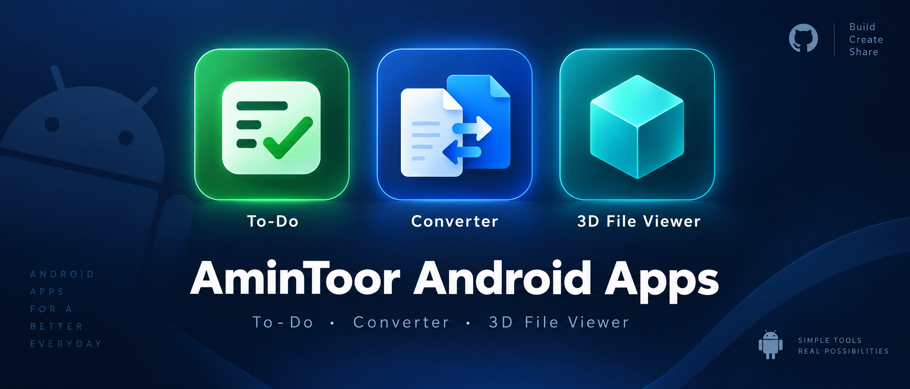

# AminToor Android Apps



A collection of lightweight, practical Android apps by **AminToor** — focused on everyday productivity, document work, and 3D models.

| App | Version | Package | Download |
|-----|---------|---------|----------|
| ✅ **AminToor To-Do** | v1.0 | `com.amintoortodo.app` | [AminToor-To-Do.apk](apps/todo/AminToor-To-Do.apk) |
| 🔄 **AminToor Converter** | v1.1.0 | `com.amintoor.converter` | [AminToor-Converter-v1.1.apk](apps/converter/AminToor-Converter-v1.1.apk) |
| 🧊 **3D File Viewer** | v1.2.0 | `com.amintoor.viewer3d` | [AminToor-3D-File-Viewer-v1.2.apk](apps/3d-file-viewer/AminToor-3D-File-Viewer-v1.2.apk) |

> All APKs in this repository are the original signed builds. Verify with the SHA-256 checksums below before installing.

---

## Apps

### 1. AminToor To-Do — simple task manager


A clean, fast to-do list for daily tasks.

**What you can do:**
- Add tasks with name + optional note
- Add due dates, including Today
- Edit tasks and delete with confirmation
- Search tasks (“Find a task”) with empty-state guidance
- Filter your list
- See “Your tasks” at a glance

**Details:**
- File: `apps/todo/AminToor-To-Do.apk`
- Package: `com.amintoortodo.app`
- Min. Android: 6.0 (API 23)
- Target: Android 12L (API 32)
- Size: 25,409 bytes (~25 KB)
- SHA-256: `6de6374ed1bac47dbaea9fdb448233aa33e26062eedccb9c3630eab7bbf804ca`

Full notes: [apps/todo/README.md](apps/todo/README.md)

---

### 2. AminToor Converter — PDF & document tools (v1.1)


Document toolkit built around PDFs, images, and Office files.

**What you can do:**
- Merge PDFs (`MergeDocuments` / PDF merge engine included)
- Split PDFs by page (`SplitAtPage`)
- PPTX → PDF (`PdfFromPptx` — supports `.pptx` files)
- Images → PDF (creates `AminToor_Images.pdf`, pick page-image folder)
- Open, view, and save edited PDFs (`Edited.pdf`)
- Page navigation and document handling

Built with Android Gradle Plugin 8.13.2. PDF engine based on PDFBox (Tom Roush port).

**Details:**
- File: `apps/converter/AminToor-Converter-v1.1.apk`
- Package: `com.amintoor.converter`
- Version: 1.1.0 (versionCode 2)
- Min. Android: 8.0 (API 26)
- Target: Android 15 (API 35)
- Size: 10,332,970 bytes (~9.85 MB)
- SHA-256: `5656224682b2572cfcc87865cf47551859f6aa10c9be75d0844d019fde5c7f30`

Full notes: [apps/converter/README.md](apps/converter/README.md)

---

### 3. 3D File Viewer — open & explore 3D models (v1.2)


A mobile 3D model viewer with library, favorites, and touch orbit controls.

**Supported formats (confirmed in app):**
`STL · OBJ · PLY · 3MF · GLB · glTF` + support files `.mtl, .bin` and textures `.png, .jpg, .jpeg, .webp`

**What you can do:**
- Open files from device file picker
- Recent files library + Search + See all
- Favorites tab
- Interactive viewer: drag to rotate, model size chip
- Model position slider (Up / Down / Centered)
- Share 3D model
- Settings tab

Built with Android Gradle Plugin 8.13.2, Three.js-based viewer (`GLTFLoader`).

**Details:**
- File: `apps/3d-file-viewer/AminToor-3D-File-Viewer-v1.2.apk`
- Package: `com.amintoor.viewer3d`
- Version: 1.2.0 (versionCode 3)
- Min. Android: 8.0 (API 26)
- Target: Android 15 (API 35)
- Size: 1,992,616 bytes (~1.9 MB)
- SHA-256: `7a25a6f4376f536c56f3df6fc463d5557e2a62d552de18a875c7d0aede096449`

Full notes: [apps/3d-file-viewer/README.md](apps/3d-file-viewer/README.md)

---

## Download & Install

1. Download the APK from the table above (or from **Releases**).
2. On your Android phone, open the APK file.
3. If asked, allow **“Install unknown apps”** for your browser / file manager.
4. Tap **Install**.
5. Verify the app name and icon match this page.

Requirements:
- To-Do: Android 6.0+
- Converter & 3D Viewer: Android 8.0+

> Tip: after downloading, you can verify integrity:
>
> ```sh
> sha256sum AminToor-To-Do.apk
> sha256sum AminToor-Converter-v1.1.apk
> sha256sum AminToor-3D-File-Viewer-v1.2.apk
> ```
>
> Compare with the checksums in [docs/CHECKSUMS.md](docs/CHECKSUMS.md).

More help: [docs/INSTALL.md](docs/INSTALL.md)

---

## Repository structure

```text
amintoor-android-apps/
├── README.md
├── assets/
│   ├── banner.png
│   └── icons/
├── apps/
│   ├── todo/AminToor-To-Do.apk
│   ├── converter/AminToor-Converter-v1.1.apk
│   └── 3d-file-viewer/AminToor-3D-File-Viewer-v1.2.apk
└── docs/
    ├── INSTALL.md
    ├── RELEASES.md
    ├── CHECKSUMS.md
    └── CHANGELOG.md
```

---

## Releases

- **v1.2.0 — 3D File Viewer**: recent-files library, favorites, position controls, GLB/glTF support
- **v1.1 — AminToor Converter**: PDF merge/split, PPTX→PDF, images→PDF
- **v1.0 — AminToor To-Do**: tasks with notes, due dates, search & filters

See [docs/RELEASES.md](docs/RELEASES.md) and [docs/CHANGELOG.md](docs/CHANGELOG.md).

---

## Privacy & permissions

- **To-Do**: no special runtime permissions found in manifest. Tasks are stored on-device (`SharedPreferences`).
- **Converter**: uses file/document access to open and save PDFs/images. Includes `DYNAMIC_RECEIVER_NOT_EXPORTED_PERMISSION` (internal broadcast protection).
- **3D Viewer**: uses file access to open models (`viewer_file_access`). Includes `DYNAMIC_RECEIVER_NOT_EXPORTED_PERMISSION`.

No accounts, no analytics SDKs observed in these builds. File access is used only to open/save files you choose.

---

## For developers

Package / activity info (from `aapt dump badging`):

| App | package | launchable-activity |
|-----|---------|---------------------|
| To-Do | `com.amintoortodo.app` | `com.amintoortodo.app.MainActivity` |
| Converter | `com.amintoor.converter` | `com.amintoor.converter.MainActivity` |
| 3D Viewer | `com.amintoor.viewer3d` | `com.amintoor.viewer3d.MainActivity` |

To inspect an APK yourself:

```sh
aapt dump badging apps/todo/AminToor-To-Do.apk
aapt dump badging apps/converter/AminToor-Converter-v1.1.apk
aapt dump badging apps/3d-file-viewer/AminToor-3D-File-Viewer-v1.2.apk
```

---

## Support

Found an issue? Open a GitHub Issue with:
1. App name + version
2. Android version + device model
3. Steps to reproduce
4. The file type you were opening (for Converter / 3D Viewer)

© AminToor. All rights reserved. APKs are distributed as-is for direct install.
